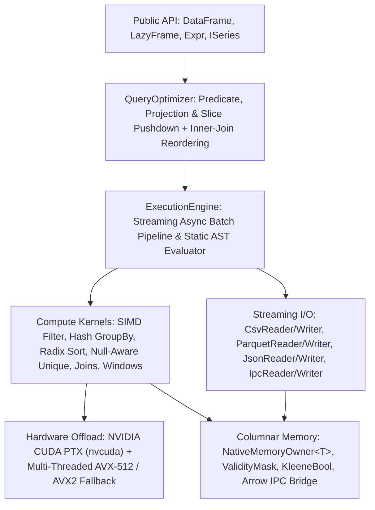

# Glacier.Polaris Architecture (`v1.1.0`)

`Glacier.Polaris` is a 100% pure C#, Native AOT-compatible columnar DataFrame and lazy relational execution engine targeting `.NET 10.0`. It combines Apache Arrow-aligned unmanaged columnar storage (`Glacier.Storage`), SIMD CPU vectorization (`Vector512<T>` / `Vector256<T>`), optional NVIDIA CUDA PTX acceleration (`Glacier.Gpu`), and a rule-based relational query optimizer.

---

## 1. Layered System Overview

---

## 2. Columnar Memory & Nullability Invariants

### 2.1 Unmanaged & Pooled Column Buffers (`src/Glacier.Polaris/Memory/`)
- **`NativeMemoryOwner<T>`**: Allocates 64-byte cache-line-aligned native memory (`NativeMemory.AlignedAlloc`) wrapped in a custom `MemoryManager<T>` so `Span<T>` and `Memory<T>` slice directly into unmanaged memory without GC heap pinning pressure.
- **Deterministic Ownership & Safe Export**: Every `Series<T>` owns its backing `IMemoryOwner<T>` and releases it deterministically on `Dispose()`. Export boundaries (`AsBytesMemory()`, `ValidityMask.GetNullBitmapMemory()`, `BooleanSeries.ToArrowColumn()`, `ObjectSeries.ToArrowColumn()`) materialize standalone byte buffers rather than leaking permanent `MemoryHandle` pins, `GCHandle` allocations, or dangling views into disposed `Utf8StringSeries` instances.
- **Non-Pinned `SchemaRegistry`**: Lookup tables use regular managed arrays (`Type[]`) with volatile reference swaps instead of permanent Pinned Object Heap (`POH`) allocations.

### 2.2 `ValidityMask` & Three-Valued Kleene Logic
- **`ValidityMask`**: Packs validity bits into `ulong[]` (`1 = valid`, `0 = null`) matching Apache Arrow's little-endian bitmap convention.
- **Tail-Bit Invariant**: Whenever `Length % 64 != 0`, unused high bits in the final 64-bit word are masked to `1` across constructors, mutators (`SetAllNull`, `And`, `Or`, `Not`, `SetWord`, `FromNullBitmap`), and word readers (`GetEffectiveWord`), guaranteeing `0 <= NullCount <= Length` and accurate `HasNulls` even if callers write raw words via `AsWritableSpan()`.
- **`KleeneBool`**: Implements three-valued Boolean logic (`True`, `False`, `NA`) for null-propagating predicates (`True | NA == True`, `False & NA == False`).

---

## 3. Native AOT Design (`IsAotCompatible = true`)

`Glacier.Polaris` compiles cleanly with `<IsAotCompatible>true</IsAotCompatible>` and `<TreatWarningsAsErrors>true</TreatWarningsAsErrors>`:
- **`ExprLambdaEvaluator`**: Evaluates user predicate/projection lambdas (`Expression<Func<Expr, Expr>>`) by walking the LINQ `Expression` tree directly instead of calling `LambdaExpression.Compile()` (which triggers dynamic code generation / `IL3050` under Native AOT).
- **Constant AST Payloads**: Multi-expression operators (`Select`, `WithColumns`, `Agg`, `Coalesce`, `Struct.WithFields`, `GroupBy`) embed typed `Expression.Constant(exprs, typeof(Expr[]))` / `Expression.Constant(columns, typeof(string[]))` nodes rather than `Expression.NewArrayInit`.
- **Static Type Dispatch**: All series cloning (`CloneEmpty`, `UniqueKernels.CreateSeriesForTake`, `CloneWithName`), empty conditional branches, external merge sort deserialization, and `DataFrame.ToDataTable()` use exhaustive pattern switches over concrete `ISeries` types rather than `Activator.CreateInstance` or `Type.GetType`.
- **Reflection-Free JSON Encoding**: `StringKernels.JsonEncode` writes directly through `Utf8JsonWriter` instead of reflection-based `JsonSerializer.Serialize`.

---

## 4. Relational `QueryOptimizer` Soundness (`src/Glacier.Polaris/QueryOptimizer.cs`)

`QueryOptimizer` applies four sound, semantics-preserving passes over the `LazyFrame` plan tree:

1. **Predicate Pushdown (`PredicatePushdownVisitor`)**:
   - **`Filter -> Select` Guard**: Blocks pushdown when `Select` contains aggregations, window functions (`.Over(...)`), row-set-changing expressions (`Unique`, `DropNulls`), or filters referencing computed projections. Rewrites aliased pass-through column references (`Col("x").Alias("y")` rewrites `y -> x`) before pushing below `Select`.
   - **`Filter -> Join` Soundness**: Resolves left/right child schemas across `ScanCsvOp`, `ScanParquetOp`, `ScanJsonOp`, `DataFrameOp`, `SelectOp`, `WithColumnsOp`, `RenameOp`, `GroupByAggOp`, and nested `JoinOp`. Constant predicates (` referencedCols.Count == 0`) are never pushed into non-preserved sides of `Left`/`Outer` joins, right-side filters are never pushed into `Left`/`Outer`/`Semi`/`Anti` joins, and left-side filters are never pushed into `Outer` joins.
   - **`Filter -> GroupByOp`**: Never pushes post-group filters blindly below `GroupByOp`.
2. **Slice Pushdown (`SlicePushdownVisitor`)**:
   - Pushes `Limit(n)` through row-preserving `Select` only when no projection contains aggregations, windows, or cardinality-changing ops (`Unique`, `DropNulls`, `Implode`), and pushes `nRows` directly into `ScanCsvOp`.
3. **Projection Pushdown (`ColumnTrackerVisitor` + `ProjectionPushdownVisitor`)**:
   - Tracks required columns top-down across `SelectOp`, `FilterOp`, `WithColumnsOp`, `SortOp`, `TopKOp`, `GroupByOp`, `AggOp`, `GroupByAggOp`, `DropNullsOp`, `UniqueOp`, `JoinOp`, `ExplodeOp`, `UnnestOp`, and `RenameOp`.
   - Treats `DropNulls(subset: null)`, `Unique(subset: null)`, `TransposeOp`, `PivotOp`, and `MapOp` as full-row barriers (`RequiresAllColumns`) so columns affecting row retention are never pruned early, and pushes projected column sets into `ScanCsvOp`, `ScanParquetOp`, and `ScanJsonOp`.
4. **Inner-Join Reordering (`JoinReorderingVisitor`)**:
   - Reorders `(A ⋈ B) ⋈ C` into `(A ⋈ C) ⋈ B` strictly when **both** joins are `JoinType.Inner` on the same key and `|C| < |B|`, wrapping the reordered join in a column-restoring projection when needed so output column names and order remain identical.

---

## 5. Compute Kernels & Hardware Acceleration (`src/Glacier.Polaris/Compute/`)

- **SIMD Filtering (`FilterKernels`)**: Uses `Vector512` / `Vector256` comparisons, bitmask extraction, and prefix-popcount index compression with adaptive `ParallelThresholds`.
- **Stable Multi-Column Sorting (`SortKernels`, `ExternalMergeSort`)**:
  - In-memory sorting uses 4-pass (`Int32`) and 8-pass (`Float64`) 8-bit LSD radix `ArgSort` preserving prior permutation indices and inverting sortable key bits for `descending` sorts so equal keys remain strictly tie-stable across chained multi-column sorts.
  - Datasets exceeding `ExternalMergeSort.DefaultSpillBudget` spill sorted runs to temporary files and merge via a K-way priority tournament.
- **Null-Aware Deduplication (`UniqueKernels`)**:
  - Single-column and multi-column row hashing/equality (`Unique`, `UniqueIndices`, `NUnique`, `ApproxNUnique`, `IsFirst`, `ValueCounts`, `UniqueRowIndices`) explicitly separate `null` from `0`, `0.0`, `false`, and `""`, retaining the first null occurrence when `maintainOrder: true`.
- **GPU Acceleration (`GpuPolarisAccelerator`)**:
  - Supports NVIDIA CUDA devices via `Glacier.Gpu` driver P/Invoke (`CuDriver`) for `Float32Series` vector arithmetic (`Add`, `Sub`, `Mul`, `Div`, `Fma`), math (`Exp`, `Log`, `Sqrt`, `Sigmoid`), and `Sum` reductions, propagating `ValidityMask` bitmaps across unary/binary ops and masking null lanes to `0.0f` before reductions.
  - When no NVIDIA GPU is available (or `GpuTarget.Cpu` is selected), execution falls back transparently to multi-threaded `Vector512<float>` / `Vector256<float>` CPU loops.
  - AMD ROCm/HIP kernels are not implemented (`IsAmdAvailable => false`, and `GpuTarget.Amd` throws `PlatformNotSupportedException`).

---

## 6. Streaming I/O Subsystem (`src/Glacier.Polaris/IO/`)

- **CSV & Parquet**: Multi-threaded chunked readers/writers supporting predicate/projection/limit pushdown.
- **Arrow IPC (`GlacierStorageBridge`, `IpcReader`, `IpcWriter`)**: Round-trips all primitive, temporal, decimal, string, and binary column types through `Glacier.Storage` (`1.0.2`) `ArrowRecordBatch` streams.
- **Multi-Column JSON (`JsonReader`, `JsonWriter`)**: Built on `System.Text.Json.Utf8JsonReader` + `System.IO.Pipelines.PipeReader`, supporting both newline-delimited JSON (`NDJSON`, with or without a trailing `\n`) and top-level JSON arrays (`[...]`), `int` -> `long` -> `double` -> `string` type promotion, `ValidityMask` nulls, exact `chunkSize` batch slicing, and early column projection.
