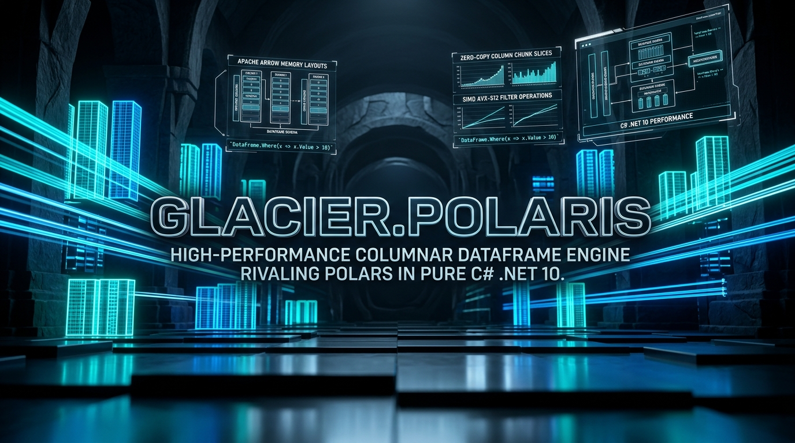

# Glacier.Polaris

[](LICENSE)
[](https://dotnet.microsoft.com/)
[](https://learn.microsoft.com/dotnet/core/deploying/native-aot/)
[](https://www.nuget.org/packages/Glacier.Polaris/)
[](https://www.nuget.org/packages/Glacier.Polaris/)

`Glacier.Polaris` is a fast, in-process DataFrame library for C# and .NET 10, inspired by [Polars](https://github.com/pola-rs/polars).

If you work with tabular data in .NET—filtering millions of rows, joining tables, running rolling windows, or transforming CSV, Parquet, and JSON files—Polaris gives you a strongly typed columnar query engine without leaving C# or shelling out to Python. Write lazy pipelines that optimize themselves before executing, or run eager operations directly in memory and ship everything inside a single Native AOT executable with no C++ runtime attached.

Read the background write-up: [I built a native C# DataFrame engine to rival Python Polars](https://dev.to/iancowley/i-built-a-native-c-dataframe-engine-to-rival-python-polars-its-actually-faster-on-some-things-opg).

## Install

```bash
dotnet add package Glacier.Polaris
```

## Quick Start

### Filter and Transform a CSV File Lazily

```csharp
using Glacier.Polaris;

DataFrame result = await LazyFrame.ScanCsv("employees.csv")
    .Filter(e => Expr.Col("Salary") > 50_000)
    .WithColumns(
        (Expr.Col("Salary") * 1.1).Alias("SalaryWithBonus"),
        Expr.When(Expr.Col("Salary") > 80_000)
            .Then("Senior")
            .Otherwise("Junior")
            .Alias("Level")
    )
    .Select(Expr.Col("Name"), Expr.Col("SalaryWithBonus"), Expr.Col("Level"))
    .Collect();
```

### Deduplicate, Sort, and Aggregate In Memory

```csharp
using Glacier.Polaris;
using Glacier.Polaris.Data;

using var df = new DataFrame(new ISeries[]
{
    Int32Series.FromValues("StoreId", new int?[] { 2, 1, 2, 1, 1 }),
    Utf8StringSeries.FromStrings("Category", new string?[] { "A", "B", "A", "B", null }),
    new Int32Series("Sales", new[] { 100, 250, 100, 400, 50 })
});

DataFrame unique = df.Unique(subset: new[] { "StoreId", "Category" }, maintainOrder: true);
DataFrame sorted = df.SortByEager(new[] { "StoreId", "Sales" }, new[] { false, true });
DataFrame grouped = df.GroupBy("StoreId").Agg(("Sales", "sum"), ("Sales", "count"));
```

## What You Can Do

- **Query files without loading everything at once:** Stream and filter CSV, Parquet, NDJSON, and JSON arrays lazily; Polaris pushes filters, column selections, and row limits down to the reader so unused data is skipped.
- **Run analytical workloads natively in C#:** Multi-column joins (`Inner`, `Left`, `Outer`, `Cross`, `AsOf`, `Semi`, `Anti`), hash grouping, stable multi-column sorting, null-aware deduplication, pivots, and rolling/expanding/exponentially weighted windows—all vectorized across your CPU cores.
- **Handle datasets larger than RAM:** Back columns with memory-mapped files (`FromMmf`), stream batches with `CollectStreaming`, sink straight to CSV/Parquet/IPC, and spill large sorts to disk.
- **Ship anywhere .NET 10 runs:** Written in pure C# with full Native AOT compatibility and no runtime reflection or dynamic code generation.

## Platform & Compatibility

- Runs on Windows, Linux, and macOS (.NET 10).
- Optional GPU vector math offload uses NVIDIA CUDA drivers (`nvcuda.dll` / `libcuda.so.1`) and falls back automatically to multi-threaded CPU SIMD; AMD ROCm and multi-GPU targets are not supported.
- Columnar IPC files use Glacier's compact binary framing (`Glacier.Formats`) and are not wire-compatible with Apache Arrow FlatBuffers IPC; use Parquet for cross-tool interchange.

## Benchmarks

Measured in Release on **AMD Ryzen AI 9 HX 370 (12C/24T Zen 5, AVX-512), 31 GB RAM, Windows 11, .NET 10.0.15 (.NET SDK 11.0.100)**:

| Workload | Scope | Mean Latency | Notes |
| :--- | :--- | ---: | :--- |
| `ArgSort_Int32` (8-bit LSD radix) | 1M / 10M rows | **6.91 ms** / **59.28 ms** | vs `Array.Sort`: 60.52 ms / 606.29 ms |
| `Filter_Int32` (AVX-512 bitmask) | 1M / 10M rows | **0.70 ms** / **1.58 ms** | — |
| `GroupBy_Hash_Int32Sum` (1,000 keys) | 1M / 10M rows | **0.59 ms** / **2.07 ms** | — |
| `Join_Inner_SmallRight` (1,000 right keys) | 1M / 10M rows | **0.78 ms** / **5.17 ms** | Left join (`N=1M`): **0.64 ms** |
| `RollingMean` (window = 5) | 1M / 10M rows | **0.78 ms** / **9.45 ms** | — |
| Compact IPC v1 Write / Read | 100k x 3 cols | **5.97 ms** / **0.74 ms** | Parquet write/collect: **34.95 ms** / **7.31 ms** |
| `GpuPolarisAccelerator.VectorAdd` | 1M `float` | **0.41 ms** (CPU) / **1.09 ms** (CUDA `Auto`) | Uncached 4 MB PCIe copy makes CPU faster at 1M |

Reproduce locally:

```bash
dotnet run --project benchmarks/Glacier.Polaris.Benchmarks/Glacier.Polaris.Benchmarks.csproj -c Release
```

## Documentation

- [User Manual](docs/manual.md) — full API reference: data types, I/O readers/sinks, `Expr` catalog, joins, windows, memory-mapped columns, and GPU math
- [Architecture](docs/architecture.md) — memory ownership, null bitmaps, Native AOT design, and optimizer soundness rules
- [Benchmarks](docs/benchmarks.md) — full 62-operation benchmark results, I/O round-trips, and GPU measurements
- [Technical Audit Report](docs/REPORT.md) — ecosystem hardening & correctness report
- [Changelog](CHANGELOG.md) — release notes

## License & Credits

Licensed under the [MIT License](LICENSE).

Developed by Ian Cowley, Antigravity (Google DeepMind), Claude and Cline/DeepSeek.
