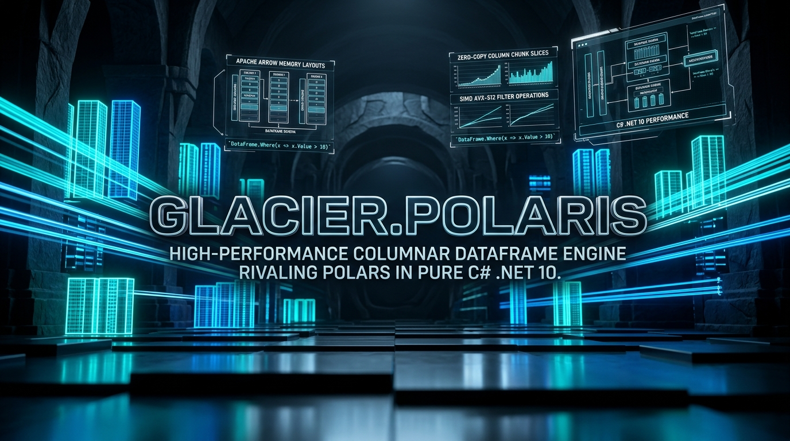

# Glacier.Polaris

[](LICENSE)
[](https://dotnet.microsoft.com/)
[](https://learn.microsoft.com/dotnet/core/deploying/native-aot/)
[](https://www.nuget.org/packages/Glacier.Polaris/)
[](https://www.nuget.org/packages/Glacier.Polaris/)
[](https://github.com/ian-cowley)
[](https://dev.to/iancowley/i-built-a-native-c-dataframe-engine-to-rival-python-polars-its-actually-faster-on-some-things-opg)
[](https://glaciersoftware.dev/)
[](https://buymeacoffee.com/glaciersoftware)

> 📖 **Read the Deep-Dive**: **[I built a native C# DataFrame engine to rival Python Polars. It’s actually faster on some things.](https://dev.to/iancowley/i-built-a-native-c-dataframe-engine-to-rival-python-polars-its-actually-faster-on-some-things-opg)**

**Glacier.Polaris** (`v1.1.0`) is a 100% pure C#, Native AOT-compatible, high-performance columnar DataFrame and lazy query engine for .NET 10, inspired by [Polars](https://github.com/pola-rs/polars) and built natively on the Apache Arrow memory layout via `Glacier.Storage`.

> [!TIP]
> For detailed architecture, memory ownership invariants, optimizer soundness rules, and execution design, see **[ARCHITECTURE.md](ARCHITECTURE.md)** and **[docs/REPORT.md](docs/REPORT.md)**.

---

## Installation

```bash
dotnet add package Glacier.Polaris
```

Or via the Package Manager Console:

```powershell
Install-Package Glacier.Polaris
```

---

## Key Features

* **100% Pure C# & Native AOT Compatible (`IsAotCompatible=true`)**: Zero runtime IL emission, zero `LambdaExpression.Compile()`, zero dynamic type construction (`Activator.CreateInstance` / `Type.GetType`). Ready for Native AOT single-file deployment.
* **Strongly Typed Columnar Memory**: 64-byte cache-line-aligned unmanaged buffers (`NativeMemoryOwner<T>`) and `Memory<T>` / `Span<T>` zero-boxing series (`Int8`–`Int64`, `UInt8`–`UInt64`, `Float32`, `Float64`, `Decimal`, `Boolean`, `Utf8String`, `Binary`, `Date`, `Datetime`, `Duration`, `Time`, `Categorical`, `Enum`, `List`, `Struct`, `Array`).
* **Arrow-Compatible Nullability & Kleene Logic**: Bit-packed 64-bit `ValidityMask` with strict tail-bit masking invariants (`0 <= NullCount <= Length`) and three-valued `KleeneBool` (`True`, `False`, `NA`) algebra across arithmetic, sorting, joins, grouping, and deduplication.
* **SIMD CPU Kernels + Optional NVIDIA CUDA Offload**: Multi-threaded `Vector512<T>` (AVX-512) and `Vector256<T>` (AVX2) CPU kernels across filters, aggregations, math, strings, and 8-bit LSD radix sorts, plus optional bare-metal NVIDIA CUDA PTX offload (`nvcuda` driver API via `Glacier.Gpu`) with automatic SIMD CPU fallback when no NVIDIA GPU is present. *(Note: AMD ROCm/HIP is not supported; `GpuTarget.Amd` throws `PlatformNotSupportedException`.)*
* **Sound Relational Query Optimizer**: Predicate pushdown (with alias rewriting and window/aggregation barriers), projection pushdown across `ScanCsv` / `ScanParquet` / `ScanJson` / `Join`, slice (`Limit`) pushdown, and cardinality-aware inner-join reordering that preserves output schema order.
* **Streaming & Out-of-Core I/O**: Pipelined CSV, Parquet, Arrow IPC (`Glacier.Storage`), and multi-column NDJSON / JSON-array (`Utf8JsonReader`) readers and writers, plus spillable K-way external merge sort.

---

## Quick Examples

### 1. Lazy Evaluation, Pushdown & Expressions

```csharp
using Glacier.Polaris;

var query = LazyFrame.ScanCsv("employees.csv")
    .Filter(e => Expr.Col("Salary") > 50_000)
    .WithColumns(
        (Expr.Col("Salary") * 1.1).Alias("SalaryWithBonus"),
        Expr.When(Expr.Col("Salary") > 80_000)
            .Then("Senior")
            .Otherwise("Junior")
            .Alias("Level")
    )
    .Select(Expr.Col("Name"), Expr.Col("SalaryWithBonus"), Expr.Col("Level"));

DataFrame result = await query.Collect();
```

### 2. Multi-Column Sorting, Null-Aware Deduplication & GroupBy

```csharp
using Glacier.Polaris;
using Glacier.Polaris.Data;

var df = new DataFrame(new ISeries[]
{
    Int32Series.FromValues("StoreId", new int?[] { 2, 1, 2, 1, 1 }),
    Utf8StringSeries.FromStrings("Category", new string?[] { "A", "B", "A", "B", null }),
    new Int32Series("Sales", new[] { 100, 250, 100, 400, 50 })
});

// Multi-column null-aware deduplication on a column subset
DataFrame unique = df.Unique(subset: new[] { "StoreId", "Category" }, maintainOrder: true);

// Stable multi-column radix sort (StoreId ascending, Sales descending)
DataFrame sorted = df.SortByEager(new[] { "StoreId", "Sales" }, new[] { false, true });

// Multi-key hash GroupBy
DataFrame grouped = df.GroupBy("StoreId").Agg(("Sales", "sum"), ("Sales", "count"));
```

### 3. Streaming Multi-Column NDJSON & JSON Arrays

```csharp
using Glacier.Polaris;
using Glacier.Polaris.IO;

// Eagerly read NDJSON or top-level JSON array [...] with automatic type inference & column projection
DataFrame jsonDf = DataFrame.ReadJson("events.ndjson", columns: new[] { "id", "timestamp", "score" });

// Or stream fixed-size record batches asynchronously via LazyFrame.ScanJson
DataFrame topScores = await LazyFrame.ScanJson("events.ndjson")
    .Filter(e => Expr.Col("score") >= 0.9)
    .Select(Expr.Col("id"), Expr.Col("score"))
    .Collect();
```

### 4. Hardware-Accelerated FP32 Math (NVIDIA CUDA or AVX-512 / AVX2 SIMD)

```csharp
using Glacier.Polaris.Compute;

float[] colA = new float[1_000_000];
float[] colB = new float[1_000_000];
float[] dst = new float[1_000_000];

// Automatically dispatches to NVIDIA CUDA when available, or multi-threaded AVX-512 / AVX2 SIMD on CPU
GpuPolarisAccelerator.VectorAdd(colA, colB, dst, GpuTarget.Auto);
```

---

## 🆕 What's New in v1.1.0

- **Full Native AOT Compatibility (`<IsAotCompatible>true</IsAotCompatible>`) & `<TreatWarningsAsErrors>true</TreatWarningsAsErrors>`**: Replaced all runtime lambda compilation (`LambdaExpression.Compile()`), `Expression.NewArrayInit`, `Activator.CreateInstance`, `Type.GetType`, and reflection-based JSON serialization with static AST evaluation (`ExprLambdaEvaluator`), typed series factories, and `Utf8JsonWriter`.
- **Sound `QueryOptimizer` Rules**: Guarded `Filter -> Select` pushdown against aggregations/windows/computed expressions (with alias rewriting on pass-through columns), guarded `Limit -> Select` against row-collapsing projections, resolved `DataFrameOp` / `ScanJsonOp` / `SelectOp` / `RenameOp` schemas in `Filter -> Join`, preserved `SortOp` / `GroupByOp` / `DropNullsOp` / `UniqueOp` columns during projection pushdown, and restricted join reordering to `JoinType.Inner` while preserving exact output column order.
- **Multi-Column Null-Aware `Unique()` & Stable Multi-Column Radix `Sort`**: Rebuilt single- and multi-column deduplication (`DataFrame.Unique`, `LazyFrame.Unique`, `UniqueKernels`) to distinguish `null` from `0`/`0.0`/`""` across all series types, fixed `DataFrame.SortBy` / `SortByEager`, and fixed tie-stability and row-index preservation in multi-column `Int32`/`Float64` LSD radix `ArgSort`.
- **Memory & `ValidityMask` Hardening**: Enforced tail-bit masking across all `ValidityMask` paths (`0 <= NullCount <= Length`), eliminated permanent `MemoryHandle` / `GCHandle` / `NativeMemoryOwner` leaks across Arrow/byte exports and `SchemaRegistry`, and added `ValidityMask` propagation to `Float32Series` hardware-accelerated operations.
- **Real Multi-Column `JsonReader`**: Streaming and eager NDJSON (with or without trailing newline) and JSON-array (`[...]`) reader over `Utf8JsonReader` with schema inference, numeric/string promotion, null masks, exact batch slicing, and column projection.
- **Supply-Chain & Backend Hygiene**: Upgraded to `Glacier.Storage` `1.0.2` and `Parquet.Net` `5.6.1` with zero vulnerable direct or transitive NuGet dependencies, removed unused packages (`Lokad.Utf8Regex`, direct `Snappier`) and all Python scripts, and quarantined unimplemented `GpuTarget.Amd` cleanly (`IsAmdAvailable == false`).

---

## Building & Testing

```bash
dotnet build Glacier.Polaris.slnx -c Release
dotnet test Glacier.Polaris.slnx -c Release --no-build
```

---

## License

Licensed under the [MIT License](LICENSE).

## ❄️ Glacier Ecosystem & Support

Part of the **[Glacier Ecosystem](https://glaciersoftware.dev/)** — high-performance developer tooling and data engines built for modern C# and .NET 10.

* 🌐 **Website & Documentation**: [glaciersoftware.dev](https://glaciersoftware.dev/)
* ☕ **Buy Me a Coffee**: [buymeacoffee.com/glaciersoftware](https://buymeacoffee.com/glaciersoftware)
* ❤️ **GitHub Sponsors**: [github.com/sponsors/ian-cowley](https://github.com/sponsors/ian-cowley)
* 🐙 **All Repositories**: [github.com/ian-cowley](https://github.com/ian-cowley)
