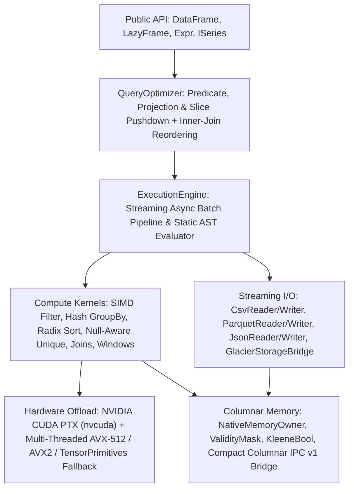

# Glacier.Polaris Architecture

`Glacier.Polaris` targets `.NET 10.0` with `<IsAotCompatible>true</IsAotCompatible>`, `<EnableTrimAnalyzer>true</EnableTrimAnalyzer>`, and `<TreatWarningsAsErrors>true</TreatWarningsAsErrors>`. It pairs contiguous columnar memory (`Glacier.Formats` and `Glacier.Storage`) with a rule-based `QueryOptimizer`, AVX-512/AVX2 SIMD CPU kernels, and optional NVIDIA CUDA PTX offload via `Glacier.Gpu`.

## Layered System Overview

## Columnar Memory & Nullability Invariants

### Unmanaged & Pooled Column Buffers (`src/Glacier.Polaris/Memory/`)
- **`NativeMemoryOwner<T>`:** Allocates 64-byte cache-line-aligned native memory (`NativeMemory.AlignedAlloc`) wrapped in a custom `MemoryManager<T>` so `Span<T>` and `Memory<T>` slice directly into unmanaged buffers without GC heap pinning pressure.
- **Ownership & Safe Export:** Each `Series<T>` owns its backing `IMemoryOwner<T>` and releases it deterministically on `Dispose()`. Export boundaries (`AsBytesMemory()`, `ValidityMask.GetNullBitmapMemory()`, `BooleanSeries.ToArrowColumn()`, `ObjectSeries.ToArrowColumn()`) materialize standalone byte buffers instead of holding permanent `MemoryHandle` pins or `GCHandle` allocations.
- **Non-Pinned `SchemaRegistry`:** Lookup tables use standard managed arrays (`Type[]`) with volatile reference swaps rather than permanent Pinned Object Heap allocations.

### `ValidityMask` & Three-Valued Kleene Logic
- **`ValidityMask`:** Stores validity bits in little-endian `ulong[]` words (`1 = valid`, `0 = null`).
- **Tail-Bit Invariant:** When `Length % 64 != 0`, unused high bits in the final 64-bit word are masked to `1` across constructors, mutators (`SetAllNull`, `And`, `Or`, `Not`, `SetWord`, `FromNullBitmap`), and word readers (`GetEffectiveWord`), preserving `0 <= NullCount <= Length` and accurate `HasNulls` even when callers write through `AsWritableSpan()`.
- **`KleeneBool`:** Evaluates three-valued Boolean logic (`True`, `False`, `NA`) across predicates (`True | NA == True`, `False & NA == False`), sorting, joins, grouping, and deduplication.

## Native AOT Design

- **`ExprLambdaEvaluator`:** Walks LINQ `Expression<Func<Expr, Expr>>` trees directly rather than calling `LambdaExpression.Compile()`, avoiding runtime IL emission (`IL3050`) under Native AOT.
- **Constant AST Payloads:** Multi-expression operators (`Select`, `WithColumns`, `Agg`, `Coalesce`, `Struct.WithFields`, `GroupBy`) store typed `Expression.Constant(exprs, typeof(Expr[]))` / `Expression.Constant(columns, typeof(string[]))` nodes instead of `Expression.NewArrayInit`.
- **Static Type Dispatch:** Series cloning (`CloneEmpty`, `UniqueKernels.CreateSeriesForTake`, `CloneWithName`), external merge sort deserialization, and `DataFrame.ToDataTable()` switch exhaustively over concrete `ISeries` implementations with zero `Activator.CreateInstance` or `Type.GetType` calls.
- **Reflection-Free JSON Encoding:** `StringKernels.JsonEncode` writes directly via `Utf8JsonWriter`.

## Relational `QueryOptimizer` (`src/Glacier.Polaris/QueryOptimizer.cs`)

`QueryOptimizer` applies four semantics-preserving passes over `LazyFrame` plans:

1. **Predicate Pushdown (`PredicatePushdownVisitor`):**
   - *`Filter -> Select` guard:* Blocks pushdown across aggregations, window functions (`.Over(...)`), row-set-changing expressions (`Unique`, `DropNulls`), or filters referencing computed projections. Rewrites aliased pass-through references (`Col("x").Alias("y")` -> `x`) before pushing below `Select`.
   - *`Filter -> Join` soundness:* Resolves left/right child schemas across `ScanCsvOp`, `ScanParquetOp`, `ScanJsonOp`, `DataFrameOp`, `SelectOp`, `WithColumnsOp`, `RenameOp`, `GroupByAggOp`, and nested `JoinOp`. Constant predicates are not pushed into non-preserved sides of `Left`/`Outer` joins; right-side filters are not pushed into `Left`/`Outer`/`Semi`/`Anti` joins; left-side filters are not pushed into `Outer` joins.
   - *`Filter -> GroupByOp`:* Blocks pushing post-group filters blindly below `GroupByOp`.
2. **Slice Pushdown (`SlicePushdownVisitor`):** Pushes `Limit(n)` through row-preserving `Select` operators and sets `nRows` on `ScanCsvOp`.
3. **Projection Pushdown (`ColumnTrackerVisitor` + `ProjectionPushdownVisitor`):** Tracks required columns top-down across `SelectOp`, `FilterOp`, `WithColumnsOp`, `SortOp`, `TopKOp`, `GroupByOp`, `AggOp`, `GroupByAggOp`, `DropNullsOp`, `UniqueOp`, `JoinOp`, `ExplodeOp`, `UnnestOp`, and `RenameOp`. Treats `DropNulls(subset: null)`, `Unique(subset: null)`, `TransposeOp`, `PivotOp`, and `MapOp` as full-row barriers and pushes pruned column lists into `ScanCsvOp`, `ScanParquetOp`, and `ScanJsonOp`.
4. **Inner-Join Reordering (`JoinReorderingVisitor`):** Reorders `(A ⋈ B) ⋈ C` into `(A ⋈ C) ⋈ B` strictly when both joins are `JoinType.Inner` on the same key and `|C| < |B|`, wrapping the reordered join in a column-restoring projection to keep output column names and order intact.

## Compute Kernels & Streaming I/O (`src/Glacier.Polaris/Compute/`, `IO/`)

- **SIMD Filtering (`FilterKernels`):** Uses `Vector512` / `Vector256` comparisons, bitmask extraction, and prefix-popcount index compression with adaptive `ParallelThresholds`.
- **Sorting (`SortKernels`, `ExternalMergeSort`):** 4-pass (`Int32`) and 8-pass (`Float64`) 8-bit LSD radix `ArgSort` preserving prior permutation indices and inverting sortable key bits for descending order so multi-column sorts remain tie-stable. Larger-than-budget inputs spill runs and merge via a K-way tournament.
- **Deduplication (`UniqueKernels`):** Explicitly separates `null` from `0`, `0.0`, `false`, and `""` across single-column and multi-column row hashing, keeping the first null occurrence when `maintainOrder: true`.
- **GPU Acceleration (`GpuPolarisAccelerator`):** Uses stack-allocated CUDA kernel parameter marshaling (`stackalloc void*[]`), overflow-checked `(nuint)` device sizing, and a bounded CUDA stream pool (`ReleaseGpuResources()`). Falls back to multi-threaded CPU SIMD when no NVIDIA GPU is available or `GpuTarget.Cpu` is requested; throws explicitly for unsupported `GpuTarget.Amd` and `GpuTarget.DualGpu`.
- **Streaming I/O:** Pipelined CSV, Parquet, NDJSON/JSON-array (`PipeReader` + `Utf8JsonReader`), and Compact Columnar IPC v1 (`GlacierStorageBridge`) readers and writers.
